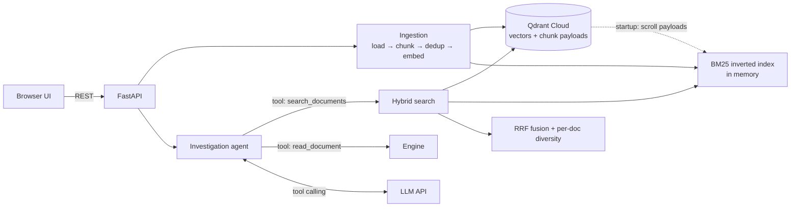

# AI Investigation Engine

Agentic RAG system that answers multi-hop questions over a large document collection (50k+ documents) with
inline citations, flags conflicting evidence, and refuses to answer when the evidence is missing.

- **Live demo:** `TODO: https://huggingface.co/spaces/<user>/ai-investigation-engine`
- **Corpus:** every unique Wikipedia paragraph in the HotpotQA validation contexts (50k+ documents) + 11 synthetic
  incident-management documents in 5 formats (change log, postmortem, status page, runbook, architecture, SLA PDF,
  team directory) with deliberate contradictions.
- **Stack:** Python 3.11 · FastAPI · Qdrant Cloud (free) · fastembed `bge-small-en-v1.5` (ONNX, CPU) ·
  own BM25 + RRF · OpenAI-compatible LLM (Gemini 2.5 Flash free tier, or Groq) · vanilla JS UI · Docker on Hugging Face Spaces.

## Architecture



| Module | Responsibility |
|---|---|
| `app/loaders.py` | `.txt .md .pdf .json .jsonl .html` → `Document` (text + metadata from front matter / JSON fields / HTML meta / PDF info) |
| `app/chunking.py` | Two strategies: `fixed` (word-aligned sliding window) and `recursive` (paragraph → sentence → word, packs whole units, sentence overlap) |
| `app/bm25.py` | **Own** BM25 Okapi with incremental add/remove, light stemming, identifier-aware tokenizer (`ledger-service`, `CHG-3301` stay whole and are also split) |
| `app/fusion.py` | **Own** Reciprocal Rank Fusion and per-document diversity cap |
| `app/store.py` | Qdrant wrapper (cloud / local disk / in-memory) |
| `app/engine.py` | Ingestion pipeline, dedup, CRUD, hybrid search, startup rebuild |
| `app/agent.py` | Tool-calling loop, evidence labelling `[S#]`, citation validation, conflict & abstention handling, degraded mode, answer cache |
| `app/llm.py` | OpenAI-compatible client: retries with backoff, `Retry-After`, timeouts, token accounting |
| `app/main.py` | REST API, upload limits, admin token, rate limiting, static UI |
| `eval/` | Eval set builder, metrics, end-to-end runner, chunking experiment |

### Request flow for `/ask`

1. **Seed retrieval:** hybrid search for the raw question (top 8). Passages get stable labels `S1…Sn`.
2. **Agent loop (max 4 steps):** the LLM sees the passages and either calls `search_documents(query)` /
   `read_document(doc)` or returns the final JSON. Multi-hop questions are decomposed by the model
   (e.g. find the change that caused INC-1042 → find who owns that service).
3. **Validation:** citations are taken from the JSON *and* inline `[S#]` markers; any label the model never saw is
   dropped and counted (`invalid_citations`). An answer with no valid citation is marked `insufficient`.
4. **Conflicts:** the prompt requires reporting both versions; conflicts are returned as structured objects with their sources.
5. **Failure handling:** missing key, rate limit, timeout, malformed tool call or non-JSON output → retries,
   a reformat request, a forced final answer, and finally a `degraded` response that still returns the evidence.
   The API never returns a 500 for LLM problems.

## Technical decisions

| Decision | Why |
|---|---|
| **Qdrant Cloud** as source of truth, BM25 rebuilt in memory at startup | Free 1 GB cluster holds ~60k × 384-d vectors + payloads. Free hosts restart/sleep: on boot the app scrolls the collection once and rebuilds BM25 + the doc registry, so nothing is lost. |
| **Own BM25** instead of Qdrant sparse vectors | Required custom algorithmic component; keeps keyword scoring transparent and testable; supports incremental CRUD. |
| **RRF** instead of score blending | Cosine and BM25 scores live on different scales; RRF needs only ranks and has one parameter (`k=60`). |
| **Per-doc diversity cap (2 chunks/doc)** | Multi-hop needs several documents in context; without the cap one long document fills the top-k. |
| **Title as chunk header** (`title\ntext` is embedded and indexed) | HotpotQA paragraphs often don't repeat the entity name; the title restores it. |
| **bge-small-en-v1.5 via fastembed** | Strong retrieval quality for 33M params, ONNX on CPU, no torch → small image, embeds 60k paragraphs locally in minutes. |
| **Agentic loop with tools** rather than one-shot RAG | Bridge questions need a second query built from the first answer; the tool trace is shown in the UI. |
| **OpenAI-compatible LLM client** | Provider is a config change (Gemini, Groq, OpenRouter, Ollama). |
| **Single static HTML UI** | One process / one container on the free tier; the brief prioritises function over visual complexity. |

## Data

- `scripts/build_hotpot_corpus.py` → every unique paragraph from HotpotQA *distractor* validation contexts
  (+ train if needed) becomes one document `hp::<title>`. Gold supporting titles give exact retrieval labels.
- `data/synthetic/` → 11 incident-management documents (9 files) across 5 formats (md, txt, json, html, pdf) built around the
  brief's example ("which change caused the March payment delays?"). Contradictions are deliberate:
  resolution time (14:20 vs 11:05), affected transactions (12,400 vs 9,800), INC-1057 root cause (partition increase vs "Kafka upgrade").
- Dedup: chunk-level SHA-1 of normalised text (case/punctuation/whitespace-insensitive), checked within a batch and against
  Qdrant; document-level hash makes re-uploads of unchanged files a no-op and changed files an update.

## Run locally

```bash
python -m venv .venv && source .venv/bin/activate
pip install -r requirements-dev.txt
cp .env.example .env            # fill QDRANT_URL / QDRANT_API_KEY / LLM_API_KEY
pytest -q                        # 28 tests, no network needed

python scripts/build_hotpot_corpus.py --target 60000
python scripts/ingest.py --synthetic --corpus data/hotpot/corpus.jsonl
uvicorn app.main:app --reload    # http://localhost:8000
```

## Deploy (free tier)

1. **Qdrant Cloud:** create a free cluster, copy URL + API key into `.env`, run the ingest above once from your machine.
2. **Hugging Face Space:** new Space → SDK *Docker* → push this repo. In *Settings → Variables and secrets* add
   `QDRANT_URL`, `QDRANT_API_KEY`, `LLM_API_KEY` (secrets) and `LLM_BASE_URL`, `LLM_MODEL`, `ADMIN_TOKEN`.
3. The image bakes the embedding model; on boot the app rebuilds BM25 from Qdrant (~30–60 s for 60k docs).

Secrets live only in `.env` (git-ignored) and Space secrets. Write endpoints require `X-Admin-Token` when `ADMIN_TOKEN`
is set; `/ask` is rate-limited per IP to protect the free LLM quota.

### Free-tier limits

| Resource | Limit | Effect |
|---|---|---|
| HF Spaces CPU basic | 2 vCPU, 16 GB RAM, sleeps after 48 h idle | First request after sleep waits for boot + BM25 rebuild |
| Qdrant Cloud free | 1 GB RAM / 4 GB disk, paused after 1 week idle | Enough for ~60k chunks; re-activate in the console if paused |
| Gemini 2.5 Flash free | per-minute and per-day request caps | Each question = 2–4 LLM calls; eval uses `--sleep` to stay under RPM |

## API

| Method | Path | Description |
|---|---|---|
| `POST` | `/ask` | `{question, mode}` → answer, short answer, citations, conflicts, insufficient flag, trace, token usage |
| `POST` | `/search` | `{query, top_k, mode}` → raw hybrid/dense/BM25 hits with per-retriever ranks |
| `POST` | `/documents` | multipart upload (one or many files, optional `chunk_strategy`) |
| `POST` | `/documents/text` | add a document from JSON |
| `PUT` | `/documents/{id}` | replace a document's content |
| `DELETE` | `/documents/{id}` | delete a document and its chunks |
| `GET` | `/documents`, `/documents/{id}` | list / inspect chunks |
| `GET` | `/health` | index stats and LLM status |

Interactive docs: `/docs`.

## Evaluation

See [EVALUATION.md](EVALUATION.md). `python eval/build_eval_set.py && python eval/run_eval.py --e2e hybrid,bm25 --sleep 6`
writes `eval/results/report.md`; `python eval/chunking_experiment.py` writes `eval/results/chunking.md`.

## Cost & performance

- Embedding: local CPU, $0. Query embeddings are LRU-cached.
- LLM: the only paid-per-use part; free tier covers the demo. Tokens per question are logged and shown in the UI.
- Answers are cached per (question, mode, index version); any ingest/delete bumps the version, so the cache never serves stale answers.
- BM25 search over 60k chunks is in-process (single-digit ms); the Qdrant round trip dominates retrieval latency.

## Known limitations

- BM25 index is in memory per process (fine for one container; multiple replicas would each rebuild it).
- Conflict detection is done by the LLM from the evidence it sees; contradictions in documents it never retrieved are missed.
- A chunk identical to another document's chunk is stored once; deleting the first owner removes that text.
- Scanned PDFs (images) are not OCR'd.
